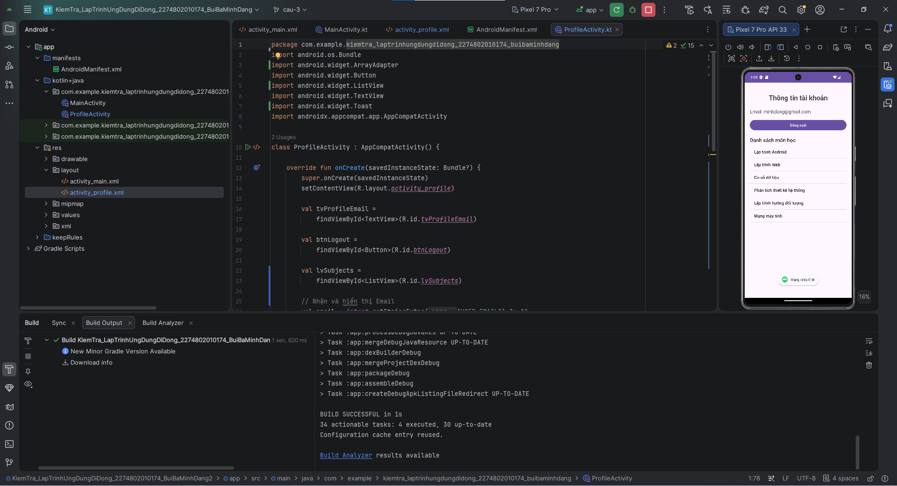

# BÀI THỰC HÀNH LẬP TRÌNH ỨNG DỤNG DI ĐỘNG

## 1. Thông tin sinh viên

- Họ và tên: Bùi Bá Minh Đăng
- Mã số sinh viên: 2274802010174
- Công nghệ: Kotlin
- Môi trường phát triển: Android Studio

## 2. Nội dung thực hiện

### Câu 1: Kiểm tra thông tin đăng nhập
- Kiểm tra email và mật khẩu không được để trống.
- Kiểm tra định dạng email.
- Kiểm tra mật khẩu có ít nhất 6 ký tự.
- Hiển thị thông báo khi dữ liệu không hợp lệ.
- Hiển thị thông báo "Xác thực thành công!" khi dữ liệu hợp lệ.

### Câu 2: Truyền dữ liệu giữa các Activity
- Tạo màn hình ProfileActivity.
- Sử dụng Intent để truyền email từ MainActivity sang ProfileActivity.
- Hiển thị email trên màn hình Profile.
- Xử lý nút đăng xuất bằng finish().

### Câu 3: Hiển thị danh sách bằng ListView
- Sử dụng ListView để hiển thị danh sách môn học.
- Sử dụng ArrayAdapter với android.R.layout.simple_list_item_1.
- Hiển thị Toast khi người dùng nhấn vào một môn học.

## 3. Cấu trúc dự án

- app/src/main/java: Chứa mã nguồn Kotlin.
- app/src/main/res/layout: Chứa giao diện XML.
- screenshots: Chứa ảnh chụp minh chứng cho từng câu.

## 4. Ảnh minh chứng

### Câu 1: Kiểm tra thông tin đăng nhập

### Câu 2: Truyền dữ liệu giữa các Activity

### Câu 3: ListView và Toast

